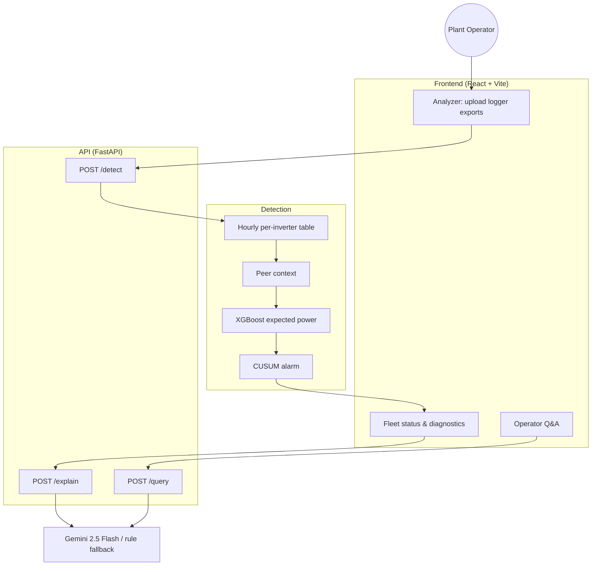

# ☀️ SolarSight: Inverter Underperformance Detection

> Spot a solar inverter that is underperforming its peers within hours, explain why, and turn it into a maintenance report an operator can act on.

SolarSight started at HACKaMINeD 2026 as a 7–10 day failure forecaster (XGBoost + SHAP + Gemini). A post-hackathon evaluation on two years of real telemetry showed that forecast wasn't supported by the data ([why](#-why-not-forecasting)). The project was rebuilt around same-day detection, which the data does support ([results](#-detection-results)).

---

## 📖 Table of Contents
- [Problem](#-problem)
- [How It Works](#-how-it-works)
- [Detection Results](#-detection-results)
- [Why Not Forecasting?](#-why-not-forecasting)
- [Getting Started](#-getting-started)
- [API](#-api)
- [Project Structure](#-project-structure)
- [Tech Stack](#-tech-stack)
- [Known Limitations](#-known-limitations)
- [Roadmap](#-roadmap)
- [Team](#-team)
- [License](#-license)

---

## 🎯 Problem

Most solar plants find a broken or underperforming inverter late: a threshold alarm on total failure, or a monthly yield report. Partial losses (a tripped string, a derated inverter, a failed MPPT input) can run for weeks, and energy not generated is never recovered.

SolarSight:
- **Flags an inverter as soon as it underperforms its peers**, usually within hours.
- Shows **evidence** for each alarm: output vs expected, zero-output hours, output vs peers, temperature vs peers, string balance.
- Turns that evidence into a **maintenance report** (Gemini, or transparent rules without an API key) and answers operator questions about the fleet.

---

## 🏗️ How It Works



1. **Load** ([`src/ml/dataset.py`](backend/src/ml/dataset.py)) — reads raw data-logger exports (`inverters[i].*`, `smu[i].string*` columns, 5-minute samples) one inverter at a time and averages them to hourly rows. It gives every inverter a unique ID, even when two loggers both number theirs from 0.
2. **Per-unit power** ([`src/ml/detection.py`](backend/src/ml/detection.py)) — scales output to each inverter's own capacity, so inverters of different sizes are comparable.
3. **Peer context** — describes conditions using only the *other* inverters in the plant at that hour (their median and spread of output, and their temperature), plus season and hour. An inverter's own fault can't leak into its expectation.
4. **Expected power** — an XGBoost regressor (MAE loss, trained on healthy hours) predicts what the inverter should produce. It also uses the inverter's usual ratio to its peers, which accounts for shading, orientation and string count.
5. **Alarm** — a one-sided CUSUM accumulates the relative shortfall and fires once it is sustained. Its slack `k` and threshold `h` are tuned on validation data against a budget of 1 alarm-day per inverter-month and shipped in [`models/detector.json`](backend/models/detector.json).
6. **Explain** ([`src/genai/narrative.py`](backend/src/genai/narrative.py)) — Gemini (JSON mode) turns the evidence into likely causes and on-site checks, using only the measured facts. Without a key, deterministic rules give the same report shape.

---

## 📊 Detection Results

Benchmarked on 2 plants (30 inverters, Mar 2024–Mar 2026): trained on the first 60% of time, tuned on the next 20%, scored on the last 20%. Real partial faults aren't labelled, so faults of known size were injected into held-out data, which is the standard approach for anomaly detection. Full results are in [`backend/reports/detection.md`](backend/reports/detection.md).

| | XGBoost expected power | Peer baseline (no ML) |
| :--- | ---: | ---: |
| Expected-power error (MAE, per-unit) | **0.013** (R² 0.989) | 0.016 (R² 0.987) |
| Same, on a plant never seen in training | 0.036–0.054 (R² 0.93) | — |
| 10% output loss detected (3-day fault) | **98%**, median 12 daylight hours | 95%, 10 h |
| 20% / 30% / 100% loss detected | 100% in 5 h / 3 h / 1 h | 100% in 5 h / 3 h / 1 h |
| Real inverter outages caught (test period) | **11 / 12** | 7 / 12 |
| Alarm-days per inverter-month, no known outage | **1.1** | 2.1 |

The ML model's advantage over the peer baseline is half the false alarms and more real outages caught at the same sensitivity. The largest alarms with no known outage are real events. One example: on 2025-11-04, all 5 inverters on one plant-2 logger produced nothing while the plant's other logger kept generating.

The bundled demo ([`frontend/public/ICR2-LT1.raws.csv`](frontend/public/ICR2-LT1.raws.csv)) is 10 unedited days of a real 12-inverter export. On 2026-01-27 at 14:00, inverter `#2` starts falling behind its peers. By the next day it produces 24% of its expected output, with 3 zero-output hours, and runs 10 °C cooler than its peers.

Reproduce from the raw `*.raws.csv` exports (`cd backend` first). This rebuilds the dataset, runs the benchmark and exports the model the API serves:
```bash
python -m src.ml.evaluate_detection --raw-dir /path/to/raw/csvs --export-model
```
```bash
pytest
```

---

## 📉 Why Not Forecasting?

The hackathon model claimed to predict failures 7–10 days ahead. Re-evaluating it from raw data showed the score was an artifact ([`backend/reports/evaluation.md`](backend/reports/evaluation.md), `python -m src.ml.evaluate`):

| Setup | Test PR-AUC | Random baseline |
| :--- | ---: | ---: |
| Hackathon: old label, random split | 0.932 | 0.062 |
| Old label, time split | no positives in test window | — |
| Inverter outages ≥ 3 h, all features, time split | 0.013 | 0.012 |
| Inverter outages ≥ 1 h, all features, time split | 0.035 | 0.031 |

- **The old label was mostly sunrise and sunset.** 88% of the "failure" hours (zero power between 06:00 and 18:00) fall at 06–07h or 17–18h, so the positive rate follows day length. A random split rewards learning that pattern.
- **Real inverter faults are rare and give no warning.** Of 1,712 zero-output hours between 08:00 and 16:00, only 117 happened while most plant peers were producing at least 5% of their capacity. The rest were plant-wide: grid, weather or logger problems. That leaves 10 outages of 3 hours or more in two years across 30 inverters. No feature set beats chance at predicting them 1–10 days ahead, nor at predicting shorter dropouts.
- **Other fixes made along the way:**
  - Leaky features (lifetime energy counter, calendar fields, plant one-hot) were removed.
  - The split is chronological with a 10-day purge, and there's a leave-one-plant-out check.
  - Literal `NaN` readings in the exports were found and fixed. They had silently removed 12 of the 30 inverters from an earlier version of the benchmark.

---

## ⚙️ Getting Started

### Prerequisites
- Python 3.11+
- Node.js 18+

### Backend
```bash
cd backend
python -m venv venv
source venv/bin/activate  # Windows: .\venv\Scripts\activate
pip install -r requirements.txt
cp .env.example .env      # optional: add a Gemini API key
uvicorn src.api.main:app --reload --port 8000
```

| Variable | Required | Purpose |
| :--- | :--- | :--- |
| `GEMINI_API_KEY` (or `LLM_API_KEY`) | No | Gemini-written diagnoses and free-form Q&A. Without it, rule-based reports and a fleet summary are returned. |
| `CORS_ORIGINS` | No | Comma-separated allowed origins. Defaults to `localhost:3000`, `localhost:5173` and the Vercel deployment. |

### Frontend
```bash
cd frontend
npm install
npm run dev               # http://localhost:3000, proxies /api to :8000
```

### Docker
```bash
docker compose up --build  # frontend on :3000, backend on :8000
```

Open **Analyzer** and click **Run Detection** (the demo export is preloaded), then click an inverter for its diagnostics. Uploads should be raw logger exports from one plant: at least 3 inverters, ideally a week or more. The upload is its own baseline, so a fault lasting most of the window gets absorbed into it.

---

## 📡 API

Interactive docs are served at `http://localhost:8000/docs`.

| Method | Endpoint | Description |
| :--- | :--- | :--- |
| `GET` | `/health` | Service status and the loaded detector's settings. |
| `POST` | `/detect` | Multipart `files`: one or more raw logger exports. Returns a fleet summary and, per inverter: status, output vs expected, alarm hours, evidence, and daily and hourly series. |
| `POST` | `/explain` | Maintenance report for one inverter (`source`: `gemini` or `rules`). |
| `POST` | `/query` | Operator question answered from the fleet's detection results. |

Status is `ALARM` (the CUSUM fired on the latest day), `WATCH` (it fired earlier in the window, or output was < 90% of expected on the latest day) or `OK`. `risk_score` is the latest day's energy shortfall in percent.

**Sample `/detect` result (trimmed):**
```json
{
  "inverter_id": "ICR2-LT1#2",
  "status": "ALARM",
  "risk_score": 76.2,
  "energy_ratio_latest_day": 0.238,
  "energy_ratio_window": 0.91,
  "alarm_hours": 9,
  "first_alarm": "2026-01-27 14:00:00",
  "evidence": [
    {"signal": "zero_output_hours", "value": 3, "typical": 0},
    {"signal": "output_vs_peers", "value": 0.312, "typical": 0.986},
    {"signal": "temp_vs_peers_c", "value": -9.765, "typical": -2.707}
  ]
}
```

---

## 📂 Project Structure

```text
SolarSight/
├── docker-compose.yml
├── backend/
│   ├── Dockerfile
│   ├── requirements.txt
│   ├── .env.example
│   ├── models/                 # expected-power model + tuned CUSUM settings
│   ├── notebooks/              # hackathon preprocessing and training (historical)
│   ├── reports/                # generated detection and forecasting evaluations
│   ├── tests/                  # pytest: loading, labels, splits, detector, API
│   └── src/
│       ├── api/                # FastAPI app, routes, schemas
│       ├── genai/              # Gemini client, diagnosis report, operator Q&A
│       └── ml/                 # dataset, detection, serving, labels, evaluation
└── frontend/
    ├── Dockerfile
    ├── public/                 # demo logger export
    └── src/
        ├── components/
        ├── pages/              # Fleet overview, Diagnostics, Analyzer, Q&A
        └── services/api.js
```

---

## 🔧 Tech Stack

| Layer | Technology |
| :--- | :--- |
| Data processing | Polars |
| Model | XGBoost (expected-power regressor), CUSUM change detection |
| Evaluation | scikit-learn, pandas, pytest |
| GenAI | Google Gemini 2.5 Flash (`google-generativeai`, JSON mode) |
| API | FastAPI, Pydantic |
| Frontend | React 18, Vite, Recharts, Framer Motion |
| Deployment | Docker, Vercel (frontend) |

---

## ⚠️ Known Limitations

- **Injected faults:** the 10–100% detection rates come from scaling real output down. Real partial faults (soiling, string trips) are less clean, and there are no labelled ones to test against.
- **Whole-logger outages:** if every inverter in an upload drops together, there's no healthy peer to compare with, and it reads as a plant-wide event. Uploading several loggers from the same plant helps.
- **Short uploads:** a fault covering most of the uploaded window becomes part of that window's baseline.
- **Data coverage:** the benchmarks cover 2 of the 3 plants; plant 3's exports weren't available.

---

## 🛤️ Roadmap

- [x] Time-based and leave-one-plant-out evaluation of the hackathon forecaster
- [x] Same-day underperformance detection with an injected-fault benchmark
- [x] Serve the detector through the API and dashboard (raw logger upload → alarms + evidence + diagnosis)
- [ ] Persist a reference period per inverter, so long faults aren't absorbed into a short upload's baseline
- [ ] Use inverter error states and alarm codes as extra evidence
- [ ] CI for the test suite
- [ ] Streaming ingestion (MQTT/Kafka) for live alarms

---

## 👥 Team

Built at HACKaMINeD 2026 (Nirma University) by Nisarg Gandhi, Jemil Patel, Veer Shah, Prachi Lalwani and Yashvi Hingrajiya.

---

## 📄 License

Released under the [MIT License](LICENSE).
